# pxl

**Pixel art as code.** You write a short `.px.js` file. pxl turns it into PNGs, sprite sheets with
JSON, animated GIFs, Tiled maps and Aseprite files, and a live browser viewer replays the painting
step by step each time you save. Sprites, animations, scenes in true perspective and 3D forms
described in meters all come out as pixel art.

pxl was made for AI agents to draw with: an agent looks at its own art in one call and fixes it. It
works by hand too. Three ways to use it:

- **As a Claude Code skill.** The repository is the skill: clone it (or link a clone) into
  `~/.claude/skills/pxl-pixel-art`, then ask Claude to draw something.
  [Use it with an AI agent](#use-it-with-an-ai-agent) has the details.
- **As a CLI.** `node bin/pxl.js build art.px.js` in a clone. You need Node 22.18 or newer and
  nothing else: no install, no build step, no runtime dependencies.
- **With a live preview.** `node bin/pxl.js serve art.px.js` opens a viewer at
  http://127.0.0.1:4321/ that rebuilds on every save and replays the painting op by op, to draw by
  hand or to watch an agent work.

> This is a fork of [crsolver/claude-pxl](https://github.com/crsolver/claude-pxl).
> **[Fork differences](docs/fork-differences.md)**: what it adds, in one page.

<p>
  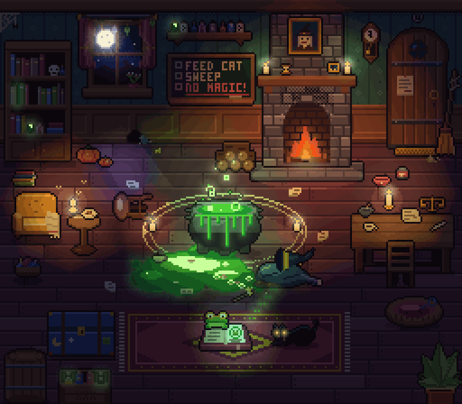
</p>
<p>
  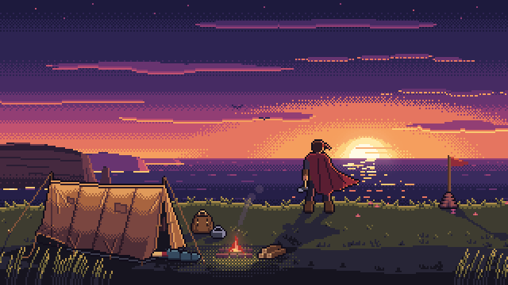
  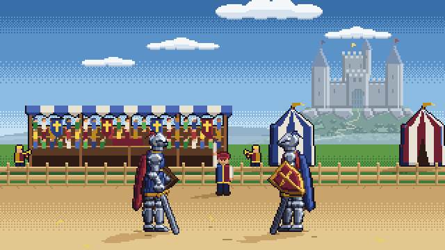
</p>
<p>
  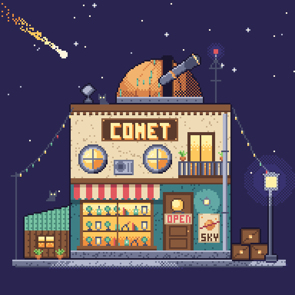
  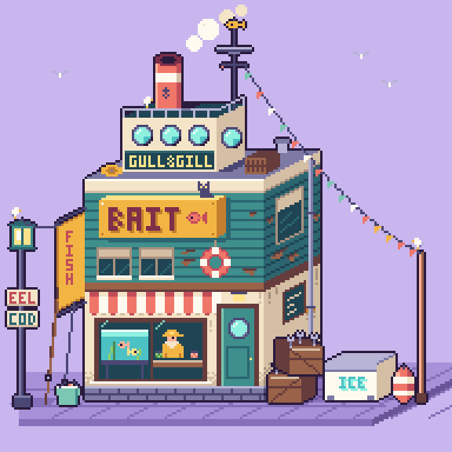
  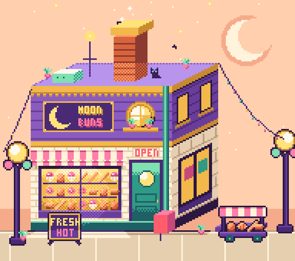
  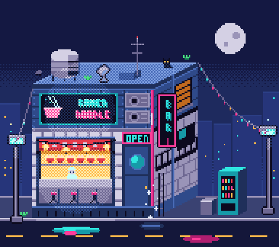
</p>
<p>
  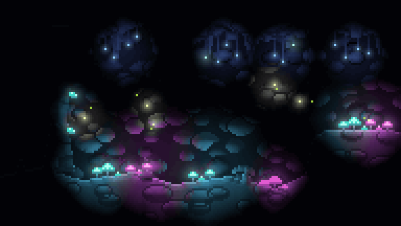
  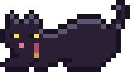
  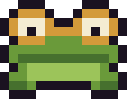
  
</p>

Every image above is generated from a file in [`examples/`](examples). The long projects are under
[Showcases](#showcases).

## Contents

- [Install](#install)
- [A first file](#a-first-file)
- [Use it with an AI agent](#use-it-with-an-ai-agent)
- [Commands](#commands)
- [What's in the DSL](#whats-in-the-dsl)
- [Documentation](#documentation): [Getting started](docs/getting-started.md) (by hand),
  [Working with an agent](docs/agents.md), [the reference](reference.md)
- [Showcases](#showcases)
- [Development](#development)

## Install

```sh
git clone --depth 1 https://github.com/augusto-scarvalho/claude-pxl.git
cd claude-pxl
node bin/pxl.js serve examples/shop.px.js     # live viewer at http://127.0.0.1:4321/
```

`--depth 1` takes the files as they are now, not every past version of the gallery's GIFs (the whole
history is several times the size); `git pull` still updates it.

Or run it without cloning:

```sh
npx github:augusto-scarvalho/claude-pxl build art.px.js
```

Below, `pxl` means `node bin/pxl.js` in a clone, or `npx github:augusto-scarvalho/claude-pxl`.
Reading JPEG, WebP or video (only `pxl study`, `pxl shot` and `pxl compare` do) needs `ffmpeg` on your PATH.

## A first file

Write `art.px.js`:

```js
pal({ k: "#1b1630", g: "#8ccf63", G: "#4c8a44", w: "#fff6e0", r: "#e2585e", R: "#a63a4c" })

// Write the left half; mirror it and outline it automatically.
sprite("slime", { mx: true, outline: "k" }, `
  ....ggg
  ..ggGGg
  .ggGwGg
  gggkwgg
  GGGGGGG`)
sprite("slime_red", { base: "slime", swap: { g: "r", G: "R" } })   // a recolor in one line

sheet("chars", ["slime*"], { pad: 1 })
```

```sh
node bin/pxl.js build art.px.js
```

```
out/sprites/slime.png  out/sprites/slime_red.png      the art, at 1x
out/chars.png          out/chars.json                 sprite sheet + TexturePacker-style JSON
out/_preview/*.png                                    upscaled previews with a pixel grid
```

`pxl serve art.px.js` opens a viewer that rebuilds on every save and replays the asset you edited op
by op, so you (or whoever is watching an agent work) can see the art being painted. It writes the
same `out/` files as `build`. Art files can also be `.ts`: `types/pxl.d.ts` gives editor completion.

[Getting started](docs/getting-started.md) goes on from here: an animation, a scene, what a build
writes, which command to use when, and learning from a reference.

## Use it with an AI agent

This repository is an agent skill. `SKILL.md` teaches the agent the workflow: write the file, look
with `pxl shot` (and read a scene as text with `pxl describe`), fix everything one look showed in one
turn, `pxl check`, `pxl build`. The agent reads the reference and the guides a section at a time
through `pxl help`, so it pays only for what the task needs.

For Claude Code, clone pxl into your skills folder, then ask Claude to draw something:

```sh
git clone --depth 1 https://github.com/augusto-scarvalho/claude-pxl.git ~/.claude/skills/pxl-pixel-art
```

`git pull` there updates it. If you already have a clone, make `~/.claude/skills/pxl-pixel-art` a
link to it instead. To be sure the skill is used, name it: "use the pxl skill to draw ...".

A change to a scene is asked for in plain words ("move the fish stall a bit left", "add a lantern
beside the tea stall"). The agent finds the thing with `pxl inspect` (what the scene holds, by id,
and where the file writes each value) and makes the change with `pxl edit`, which writes it there,
refuses it if anything else would move, and says what changed by id: as right as an edit by hand,
16% cheaper and slower in [a first measure](docs/evaluation-edit.md).

The Codex CLI, Antigravity's `agy` and other agents install it differently: see
[Install the skill](docs/agents.md#install-the-skill). [Working with an agent](docs/agents.md) also
covers which model and effort to pick (in the [model study](docs/model-study.md), Opus at xhigh was
the sweet spot), writing a brief, a round in stages you approve one by one, asking for an edit,
what a session and a frame cost, when to draw in 3D and when by hand, one agent or a pipeline for a
big scene, and reviewing the result.

## Commands

```
pxl build <art.px.js>             PNGs, sheets + JSON, GIFs and previews in out/ (--only a,b, --share N, --aseprite)
pxl serve <art.px.js>             the live viewer: rebuilds on save and replays the painting (an HD scene's
                                  frames built as it plays them); /3d turns the exported 3D models round
pxl shot <art.px.js> <name>       one asset as a picture to look at: frames side by side (in rows when too
                                  wide), a region enlarged, values only (--grey), guide layers over it (--ref),
                                  the last commit above and the pixels that changed (--vs HEAD --diff); more
                                  names a row each, or playing side by side in one GIF (--gif, --every N for a
                                  long scene's preview); a reference GIF, WebP or video too
pxl ascii <art.px.js> <name>      an asset as palette keys with x/y rulers
pxl describe <art.px.js> <name>   a whole scene as text: what is where, what covers it, how it moves
pxl check <art.px.js>             warnings on every scene and frame; LOOK lines on hand-drawn lines; a
                                  scene's rules, expect and expect3d (--fix: a failing one fixed by one number)
pxl inspect <art.px.js> <scene>   what an edit can name in a scene, by id (--find words); --id x: its values,
                                  where the file writes each, the operations it takes
pxl edit <art.px.js> <scene> <edit>
                                  a move, recolor, flip, swap, relation or new stamp written where the value
                                  lives, refused if anything else moves, then what changed by id and the
                                  check; --dry shows it first
pxl steps <art.px.js> <name>      how it was painted; --at x,y names the line that painted that pixel
pxl list <art.px.js>              a map of the file: each definition's lines and comment
pxl lib [entry]                   the library: its entries by subject (--genre, --cell), an entry's card;
                                  draft draws a 3D entry in a genre (--genre) or at a cell it lacks
pxl compare <art.px.js> <name> <ref.png | other>   silhouette rows against a reference or another asset
pxl blind <art.px.js> <name...>   facing labels checked by a reader who doesn't know them
pxl study <picture or clip>       learn from finished art or a reference, and what to use in pxl for each part
pxl help [name]                   the reference on an op or option, or a guide's section
```

`pxl` alone prints every command with all its options. [Which command, when](docs/getting-started.md#which-command-when)
says which to reach for.

## What's in the DSL

- **Palettes and ramps**: one-character color keys, built-in palettes (pico8, sweetie16, endesga32…),
  Lospec files, dark→light ramps that drive `shade()` / `light()`, `shades()` for a hue-shifted ramp
  from one color.
- **Sprites**: text grids, mirroring, auto-outline (plain, selective, inside, with dark `caps` where a
  line steps), palette-swap variants, flips and rotations by any angle, reusable `_parts`, `stamp`,
  anti-aliasing as by hand (`aa`).
- **Primitives and brushes**: rects, lines and curves drawn pixel-perfect, circles, polygons,
  gradients (dithered, or by whole rows: `grad(..., "lines")`), dithering, noise, pixel fonts (a 3×5
  built in, a 5×7 to include, `mono` for a score), `scatter` brushes, tilemaps, paths along a
  polyline that fan round their bends (`lane()`), random groups with reproducible seeds.
- **Scenes**: layers, cast-shadow and light layers, per-layer PNG export. Props placed by a relation
  (`beside`, `on`, `along`, `apart`) follow what they go with; the scene's rules (`expect`: a gap, an
  order, inside a region, on the ground) are held by `pxl check` at every frame and mended by
  `--fix`; an `id` names a placement to `describe`, `inspect` and `edit`.
- **Animation**: frames as patches over a base sprite → strips + JSON tags + GIF; motion blur
  (`stamp(..., { smear })`); parts half a pixel along (`stamp(..., { sub: true })`) for an idle
  without the single-pixel bob. A scene runs on the clock of what it stamps, or on its own:
  `scene(..., { frames, fps })`.
- **Characters**: `rig()` skeleton first (slots, stand-ins, parts ordered by facing, turned with
  `twin` parts), `ik` for poses, `register` by the pelvis; `rig3d()` a figure posed in 3D and drawn
  in 4, 8 or 16 directions (flat blocks first, `gait()` for the walk, the head modeled, baked once
  per view and its face retouched by hand); `route()` walks it through a story and `bubble()` gives
  it dialogue boxes (see [`characters.md`](characters.md)).
- **Lighting** (optional): lamps, glow, normal-based relief (see [`lighting.md`](lighting.md)).
- **In meters**: a camera with one, two or three vanishing points (`perspective()`), ground
  (`plane()`), hills (`terrain()`), things built of solid shapes and their shadows (`solids()`,
  `shadows()`), faces you are inside of (`mesh()`), and after a `mesh()` a camera's depth of field,
  haze and bloom (`post()`, the HD-2D look); see [`scenes.md`](scenes.md).
- **3D as code**: forms in meters as distance fields drawn as pixel art (`surface()`), as voxels
  (`voxels()`), meshes (`mesh()`), air (`volume()`: mist, smoke, a glowing orb) or Gaussian splats;
  leaves and moss scattered on them, hand-drawn decals pinned on them; a scene of named parts
  (`world3d`, builders such as `make3d.tree` and `make3d.pine`) edited by name, with rules
  (`expect3d`) that `pxl check` runs and `--fix` repairs; one thing drawn as any of them
  (`draw3d(thing, { as })`); turned into a game's sprites, one per heading (`turnaround()`); standing
  in a `mesh()` diorama's sun and shadows (drawn after it); out to other tools as `.vox`, `.obj`,
  `.glb` (one that plays, for something that moves) and `.ply`. See [`scenes.md`](scenes.md) §17.
- **Going by in a loop**: parallax planes (`scroll()`, across or, with `axis: "y"`, down the
  picture; pxl warns when a plane would judder), `clouds()`, smoke and steam (`plume()`, and
  `smoke()` in shapes: a column on a path, a puff, a bank, a ring).
- **Effects, as shaders do them, on the CPU**: `effect()` on a sprite, an anim's frame or a layer, on
  the clock: a dissolve in patterns and looks (burn with flames, acid, frost, magic, neutral),
  pixelate, dither to the palette, tint, a UV distortion, a plant swaying in the wind, an aura, energy,
  emission that lights `mesh()`; on one placement with `fx`. Abilities on the clock: `ability()`
  phases, `emitter()` particles, `trail()`; a spell kit, `spell("fire", 3, { from, to })`: nine
  elements at three tiers (fire, fira, firaga), each a recipe to start one's own from, with variants
  (an iceberg, a falling boulder, a quake, a meteor, a wave...) and views (side, top-down, isometric,
  a perspective camera, where it is drawn in a `mesh()` diorama's depth and lights it);
  `post()`'s finish (Three's bloom, a LUT from a `.cube` file or a strip PNG, grain, sharpen, the
  picture back in the palette).
- **Out**: sprite sheets with JSON tags (`rows: "tag"`: an animation a row; the sheet's preview GIF
  plays them all), GIFs, Tiled maps (`.tmj`), Aseprite files to keep editing.
- **Errors** point at `file:line:col` and the asset/layer/op path, with "did you mean…" hints.

## Documentation

| For | Read |
| --- | --- |
| a first sprite, an animation and a scene by hand; which command when | [docs/getting-started.md](docs/getting-started.md) |
| running an agent: install, model and effort, briefs, a round in stages, edits by name, costs, 3D or by hand, review; tests and tools for contributors | [docs/agents.md](docs/agents.md) |
| which model and effort to draw with: one scene, seventeen runs | [docs/model-study.md](docs/model-study.md) |
| whether the 3D layer helps agents: four comparisons, each run once an arm | [docs/evaluation-3d.md](docs/evaluation-3d.md) |
| whether `inspect` and `edit` make a small edit cheaper than editing the file: six edits, two arms | [docs/evaluation-edit.md](docs/evaluation-edit.md) |
| every op and option | [reference.md](reference.md), or `pxl help <name>` |
| the agent's workflow, and where to read each thing | [SKILL.md](SKILL.md) |
| which example teaches what, a line each | [examples/README.md](examples/README.md) |
| the library: props, nature, characters, buildings to `include`, a card each, a sheet per subject | [lib/README.md](lib/README.md), or `pxl lib` |
| scenes, perspective, HD-2D dioramas, parallax, shadows | [scenes.md](scenes.md) |
| grass, trees, bushes, rocks, walls and paths as games draw them | [environment.md](environment.md) |
| characters, animation with parts, rigs | [characters.md](characters.md) |
| lamps, walls that block light, normal maps | [lighting.md](lighting.md) |
| turning a sprite by any angle, 8 or 16 directions | [rotation.md](rotation.md) |
| what this fork adds to the original | [docs/fork-differences.md](docs/fork-differences.md) |
| what is still open | [BACKLOG.md](BACKLOG.md) |

## Showcases

Long projects made with pxl by agents, most over rounds of a curator's notes, the strongest first.
Each is in [`examples/`](examples) to read and copy. Smaller files to start from (the starter
`basics.px.js`, tilesets) are in the [list of examples](examples/README.md); characters, props,
grass, trees and rocks to include are in [the library](lib/README.md).

### HD-2D dioramas: a graveyard, a harbor, a clearing

<p>
  
</p>
<p>
  
</p>
<p>
  
</p>

The look of Octopath Traveler's dioramas, in [`examples/hd2d/`](examples/hd2d): the ground built in
meters with `mesh()` (textured boxes laid a texel to a pixel, a hill with an uneven outline), people,
stones and trees standing in it as sprites, shadows from one sun, `post()`'s depth of field. The
traveler ([`traveler.px.js`](examples/hd2d/traveler.px.js)) is a 34 px figure in 3D (`rig3d()`),
his head modeled, baked once per view and its face painted over by hand: he walks his eight
directions along a `route()`, kneels to lay a rose and talks in `bubble()` boxes. In
`graveyard_3d`, beside the graveyard, its dead tree, a ground mist and the swinging gate are drawn in
3D inside the diorama's light (what they take after its `mesh()`), 0.7 s a frame. The harbor's camera was matched by
measuring a screenshot of Octopath Traveler II; its crew ([`crew.px.js`](examples/hd2d/crew.px.js))
is dressed on the traveler's skeleton. The clearing ([`clearing.px.js`](examples/hd2d/clearing.px.js))
has every shader at once: a wood swaying in one wind, a fireball cast from the traveler's hand by the
spell kit, hidden by the wall on its way, a scarecrow burning away, smoke, sparks, bloom and a
`.cube` grade.

### A Japanese shrine in autumn

<p>
  
</p>

[`examples/shrine/`](examples/shrine): a top-down courtyard whose props are drawn once in 3D and
turned by `turnaround` (the torii, the hall, the lanterns, the foxes), under one sun that lights the
3D, the light rule and the shadows. The miko is a `rig3d` figure with a head modeled, baked per view
and retouched by hand. The path is laid along a polyline by `lane()`; the trees come from a kit of
species ([`nature/trees.px.js`](examples/nature/trees.px.js)) built on one grower, each in its
seasons; the Japanese ground and buildings are a kit too ([`nature/japan.px.js`](examples/nature/japan.px.js)).
It began as a fresh agent's dogfood made with only the skill, and was then reworked in stages.

### 3D as code: fields, voxels, volumes, splats, decals

<p>
  
</p>

Everything here is described in meters, in code, and drawn as pixel art by pxl itself, on the CPU
([`examples/sdf/`](examples/sdf)): the forms are distance fields drawn by `surface()`, the mist and
the smoke densities ray-marched by `volume()`, the leaves and moss details scattered on the forms, the
door, the sign and the spirit's face hand-drawn decals pinned on them. The scene is data
(`world3d`): "a denser canopy, twistier branches, wind from the left" is an edit that leaves the house
and the rock byte for byte as they were, and its rules are checked by `pxl check`. The same fields
go out as voxel models, meshes and splats (`.vox`, `.obj`, `.glb`, `.ply`), or as a game's sprites
turned to each heading by `turnaround` ([`turnaround.px.js`](examples/sdf/turnaround.px.js)).

### A spell kit: elements, tiers, variants, views

<p>
  
</p>

A whole cast in one call, `spell("ice", 3, { from: "hero.hand", to, variant: "iceberg" })`
([`spells.px.js`](examples/spells.px.js), [`spell_variants.px.js`](examples/spell_variants.px.js)):
nine elements at three tiers, variants with a form (an iceberg, a falling boulder, a quake, a
meteor), seen from the side, from above, in iso or through a camera, in a diorama's depth.

### A cyberpunk street at dusk, made two ways

<p>
  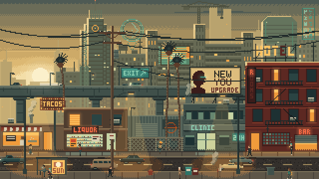
</p>
<p>
  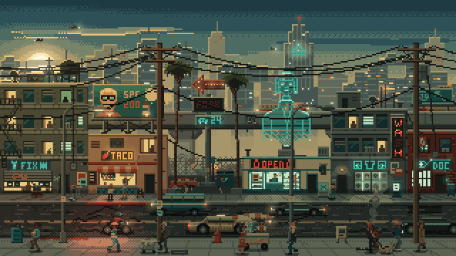
</p>

One brief, a 320×180 street, made twice from the skill alone ([`examples/cyberpunk/`](examples/cyberpunk)).
On top, one agent: 85 turns in 31 minutes. Below, a pipeline (a planner, eight forks drawing parts at
once, a last fork assembling): denser but less coherent, for about five times the tokens and twice
the time.

### Knights built skeleton first, at a tournament

<p>
  
</p>

A 72 px knight built as [`characters.md`](characters.md) §11 describes ([`examples/rig/`](examples/rig)):
a `rig()` of slots with stand-ins, parts drawn from plates lit on their own, ordered by the way he
faces and turned with `turn`; each pose of the 96-frame bout set by IK, the sparks, dust and fanfare
on one clock.

### True perspective

<p>
  
</p>
<p>
  
</p>
<p>
  
</p>

Scenes laid out in meters through a camera ([`examples/perspective/`](examples/perspective)): the
[road](examples/perspective/road.px.js) in one point, the walker shrinking into sprites drawn by hand
for the small sizes; the [park](examples/perspective/park.px.js) in two, solid shapes cast by one sun;
the [extinction](examples/perspective/extinction.px.js) in three, a volcano by `terrain()` and
everything burning by `flame()`.

### Parallax and a cockpit

<p>
  
</p>
<p>
  
</p>

The [train](examples/parallax/train.px.js): the land runs past in planes that wrap (`scroll`), each a
whole number of px a frame, so none judders and the loop closes. The
[race](examples/perspective/race.px.js): the road bending through the camera, rivals drawn by hand at
seven sizes, the cockpit modelled in meters and drawn by `mesh()`, each mirror another camera.

### Journey's end, a Halloween party, a tropical forest

<p>
  
  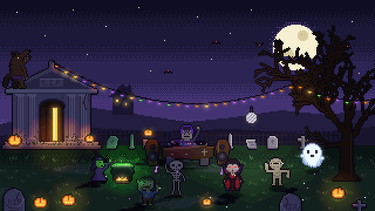
  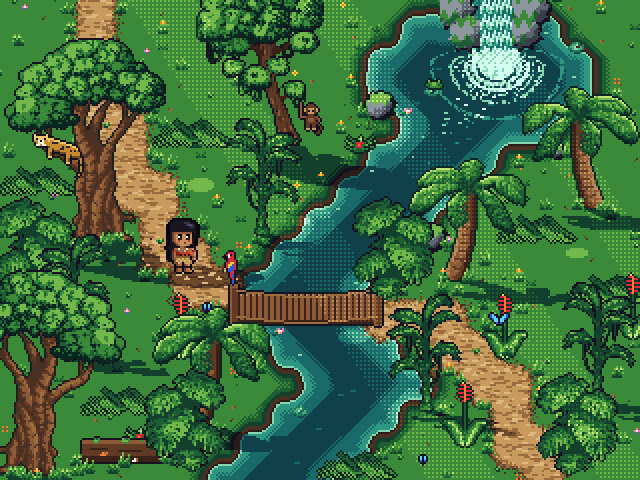
</p>

A backlit sunset on a sea cliff ([`examples/sunset/`](examples/sunset)): what faces us in shadow,
edges toward the sun glowing, a tent lit through, a sky looping slower than the rest. A night party
lit only by `lighting()` ([`examples/halloween/`](examples/halloween)): eight monsters on one cycle,
throwing their silhouettes away from the lamps. The first long project, a 320×240 jungle
([`examples/tropical/`](examples/tropical)): its trees, palms and big leaves are reduced from "[LPC]
Jungle" by bluecarrot16, Lanea Zimmerman (Sharm), Sevarihk, Hyptosis and others, and from Sevarihk's
"Animated Palm Tree Sprite", both CC-BY 4.0: credit their authors when you reuse them
([`refs/CREDITS.md`](examples/tropical/refs/CREDITS.md)). The rest is drawn in code, MIT.

## Development

```sh
npm install                                          # dev only: typescript, @types/node
node --test test/docs.test.ts                        # one test file, while you iterate
PXL_EXAMPLES=hd2d node --test test/examples.test.ts  # the examples' check on one folder
npm run test:quick                                   # every test but the two slowest (9-16 s; ~45 s after a change to pxl's sources)
npm run check                                        # type check + every test (13-20 s; ~2 min after an engine change), before a commit
```

```
src/core/     engine, no Node APIs: image, palette + ramps, canvas ops, build, trace, project, study
src/node/     vm sandbox loader, PNG/GIF encoders, outputs, CLI, live server
src/viewer/   browser viewer (served type-stripped; no bundler)
types/        pxl.d.ts globals for editor support in .px.ts files
scripts/      the maintainers' scripts, below
examples/     example art files
test/         node:test suites
```

| Script | What it does |
| --- | --- |
| `scripts/build.js` | writes `dist/` for npm installs |
| `scripts/gallery.ts` | regenerates `docs/gallery/` from the examples (`--out DIR` to look first, `--every N` for a quick look; `--lib`: the library's sheets) |
| `scripts/calibrate.ts` | scores `pxl study` against the examples' own source |
| `scripts/perf.ts` | `pxl check`'s time, processor time and peak memory on every example; `--vs <rev>`: ms a frame, that revision's pxl against yours |
| `scripts/hashes.ts` | a hash of every asset of the files given (none: every example); `--vs <rev>`: what differs from that revision's pxl, `--frames` frame by frame, for an engine change that shouldn't move a pixel |
| `scripts/vs.ts` | what `hashes.ts`, `perf.ts` and `served.ts` share: a revision's `src/` and `examples/` unpacked once into the temp folder |
| `scripts/served.ts` | what the live viewer sends and holds for one asset (`--vs <rev>`: that revision's server first) |
| `scripts/pulse.ts` | how many of an animation's normals turn from frame to frame on the parts that only moved |
| `scripts/meter.ts` | preloaded into the tests, each test file's time, processor time and peak memory |
| `scripts/cpuprofile.ts` | a CPU profile of any pxl command, summed by function |
| `scripts/tokens.ts` | where a Claude Code session's tokens went, read from its transcript |
| `scripts/model-study.sh` | one run of the [model study](docs/model-study.md): a brief to a new Claude Code, Codex or `agy` session |
| `scripts/eval3d.ts` | what an edit of a 3D scene changed, part by part, and what it shouldn't have ([evaluation-3d.md](docs/evaluation-3d.md)) |
| `scripts/evaledit.ts` | what an edit of a scene changed, by id, and the pixels outside what the request names ([evaluation-edit.md](docs/evaluation-edit.md)) |
| `scripts/mhtml.ts` | saved web pages (`.mhtml`) opened as text and images, to read tutorials |

How to use them, and how to update the examples' snapshot after a change you meant, is in
[Working with an agent](docs/agents.md#for-contributors).

In a clone the CLI runs the TypeScript sources directly. When installed as a package it runs
`dist/`, which `npm install` / `npm pack` generate via `scripts/build.js` (Node won't strip types
inside `node_modules`).

## License

[MIT](LICENSE)
