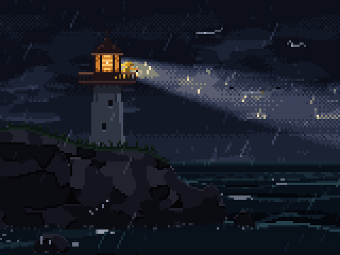
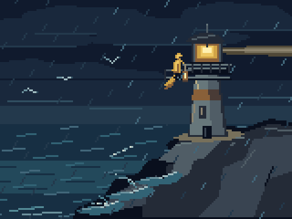
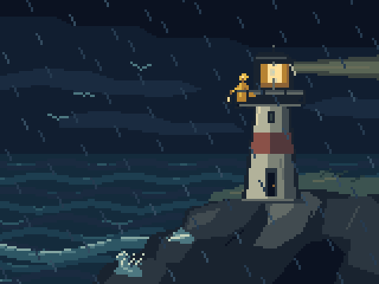
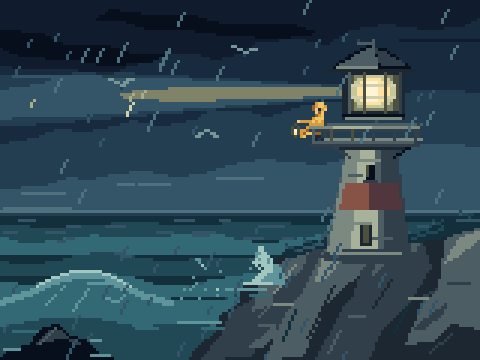
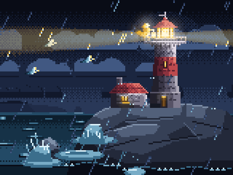
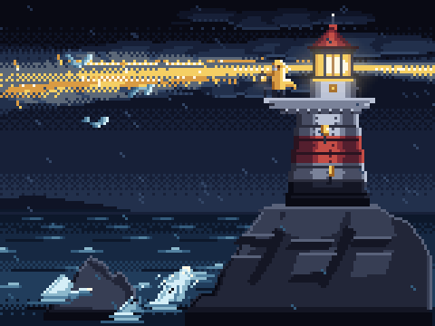

# Which model, how much effort: one scene, seventeen runs

One brief given to fresh agents with the pxl skill, each on a different model or effort level, to
see what more thinking buys in pixel art and what it costs: eight in Claude Code, six in the Codex
CLI, three in Antigravity (Gemini 3.8 Flash, and Gemini 4 Argon twice). Run on 2026-10-21; every
number below comes from the runs themselves (Claude Code's result for each session, its transcript
read by [`scripts/tokens.ts`](../scripts/tokens.ts); Codex's events and session log; Antigravity's
result), and the art was judged blind and by the curator.

**In short:** on Opus, the cost doubled at every step of effort ($0.54, $2.17, $4.71, $9.62,
$20.01). The curator, watching the loops, put max first, xhigh close behind and high a step down:
**xhigh is the sweet spot**, nearly max's art at half its cost. A blind agent judging stills put
xhigh and high together at the top. Sonnet at xhigh cost as much as Opus at high and scored lower;
Haiku was the cheapest by far and got the scene's space wrong; Fable at high cost more than Opus at
high and scored lower. **In Codex**, six runs cost $0.16 to $3.24 at OpenAI's API prices, in minutes
each; the curator found every one of them well below the Claude scenes, while the blind agent ranked
two of them first. The agent judging stills got it the wrong way round: the review that counts is a
person watching the loops. Through Antigravity, Gemini 3.8 Flash at high took 42 minutes for about
$1.62, and Gemini 4 Argon at high 42 minutes for about $3.15, once a trap in pxl it fell into the
first time (fixed) was out of the way. One run each, one brief: read it as a first measure, not a
law.

## Contents

- [The brief](#the-brief)
- [Every run at a glance](#every-run-at-a-glance)
- [The art](#the-art), every GIF with who made it and what it cost
- [How it was run](#how-it-was-run)
- [Claude Code: the numbers](#claude-code-the-numbers)
- [The curator's review](#the-curators-review)
- [What the numbers say](#what-the-numbers-say)
- [Where the tokens went](#where-the-tokens-went)
- [The same brief in Codex](#the-same-brief-in-codex)
- [The same brief in Antigravity](#the-same-brief-in-antigravity)
- [What to use](#what-to-use)
- [What this doesn't show](#what-this-doesnt-show)
- [Doing it again](#doing-it-again)

## The brief

A new scene, like none of the examples, that asks for light, weather, a character at a small scale
and a loop ([`study/lighthouse/brief.txt`](study/lighthouse/brief.txt), word for word):

> a 160x120 animated pixel-art scene: a lighthouse on a rocky headland on a stormy night. The lamp's
> beam sweeps through the slanting rain; waves break on the rocks below and throw up spray; a keeper
> in a yellow oilskin stands on the gallery holding a lantern, the coat flapping in the wind; a few
> gulls struggle against the wind. The lamp is the light: say where it comes from. Loop it
> seamlessly. Original art. > Work until you would show it to a pixel-art curator, then reply with
> the art file's path, the scene's name, and two lines on what you'd improve next.

Each agent was told to use the pxl skill, to keep its files in its own folder, not to spawn agents
and not to ask questions.

## Every run at a glance

One row per run, in the order of [the art](#the-art) below. Each run's GIF and source are named by
who made it: `claude-<model>-<effort>`, `codex-<model>-<effort>`, `agy-<model>-<effort>`, in
[`study/lighthouse/`](study/lighthouse) (the source's first line says it too).

| Tool | Model | Effort | Art | Cost | Time | Turns | Blind, of 8 | Blind, of 14 | Curator | pxl |
|---|---|---|---|---:|---:|---:|---|---|---|---|
| Claude Code | Opus 5.5 | low | [gif](study/lighthouse/claude-opus-low.gif), [src](study/lighthouse/src/claude-opus-low.px.js) | $0.54 | 2 min | 14 | 3, 8th | 4, 12th | | `5929a59` |
| Claude Code | Opus 5.5 | medium | [gif](study/lighthouse/claude-opus-medium.gif), [src](study/lighthouse/src/claude-opus-medium.px.js) | $2.17 | 9 min | 42 | 5, 5th | 5, 8th | | `5929a59` |
| Claude Code | Opus 5.5 | high | [gif](study/lighthouse/claude-opus-high.gif), [src](study/lighthouse/src/claude-opus-high.px.js) | $4.71 | 22 min | 75 | **7, 2nd** | 6, 5th | 3rd | `5929a59` |
| Claude Code | Opus 5.5 | xhigh | [gif](study/lighthouse/claude-opus-xhigh.gif), [src](study/lighthouse/src/claude-opus-xhigh.px.js) | $9.62 | 34 min | 122 | **7, 1st** | 7, 4th | **2nd, the sweet spot** | `5929a59` |
| Claude Code | Opus 5.5 | max | [gif](study/lighthouse/claude-opus-max.gif), [src](study/lighthouse/src/claude-opus-max.px.js) | $20.01 | 68 min | 187 | 6, 3rd | 5, 10th | **1st** | `5929a59` |
| Claude Code | Sonnet 5.5 | xhigh | [gif](study/lighthouse/claude-sonnet-xhigh.gif), [src](study/lighthouse/src/claude-sonnet-xhigh.px.js) | $5.32 | 31 min | 100 | 6, 4th | 4, 11th | | `5929a59` |
| Claude Code | Haiku 5.5 | xhigh | [gif](study/lighthouse/claude-haiku-xhigh.gif), [src](study/lighthouse/src/claude-haiku-xhigh.px.js) | $0.37 | 9 min | 45 | 4, 6th | 3, 13th | | `5929a59` |
| Claude Code | Fable 5.1 | high | [gif](study/lighthouse/claude-fable-high.gif), [src](study/lighthouse/src/claude-fable-high.px.js) | $7.05 | 17 min | 41 | 4, 7th | 3, 14th | | `5929a59` |
| Codex CLI | gpt-6.1-sol | low | [gif](study/lighthouse/codex-gpt-6.1-sol-low.gif), [src](study/lighthouse/src/codex-gpt-6.1-sol-low.px.js) | ≈ $0.16 | 1.3 min | 9 | | 6, 6th | below Claude's | `0e8f7cb` |
| Codex CLI | gpt-6.1-sol | medium | [gif](study/lighthouse/codex-gpt-6.1-sol-medium.gif), [src](study/lighthouse/src/codex-gpt-6.1-sol-medium.px.js) | ≈ $0.18 | 1.7 min | 9 | | 6, 7th | below Claude's | `0e8f7cb` |
| Codex CLI | gpt-6.1-sol | high | [gif](study/lighthouse/codex-gpt-6.1-sol-high.gif), [src](study/lighthouse/src/codex-gpt-6.1-sol-high.px.js) | ≈ $0.36 | 3.6 min | 15 | | **8, 2nd** | below Claude's | `0e8f7cb` |
| Codex CLI | gpt-6.1-sol | xhigh | [gif](study/lighthouse/codex-gpt-6.1-sol-xhigh.gif), [src](study/lighthouse/src/codex-gpt-6.1-sol-xhigh.px.js) | ≈ $0.66 | 7.2 min | 28 | | 5, 9th | below Claude's | `0e8f7cb` |
| Codex CLI | gpt-6.1-sol | max | [gif](study/lighthouse/codex-gpt-6.1-sol-max.gif), [src](study/lighthouse/src/codex-gpt-6.1-sol-max.px.js) | ≈ $0.84 | 10.2 min | 32 | | 7, 3rd | below Claude's | `0e8f7cb` |
| Codex CLI | gpt-6-astra | xhigh | [gif](study/lighthouse/codex-gpt-6-astra-xhigh.gif), [src](study/lighthouse/src/codex-gpt-6-astra-xhigh.px.js) | ≈ $3.24 | 5.6 min | 22 | | **8, 1st** | below Claude's | `0e8f7cb` |
| Antigravity | Gemini 3.8 Flash | high | [gif](study/lighthouse/agy-gemini-3.8-flash-high.gif), [src](study/lighthouse/src/agy-gemini-3.8-flash-high.px.js) | ≈ $1.62 | 42 min | | | | not yet | `99127e2` |
| Antigravity | Gemini 4 Argon | high, 1st run | [gif](study/lighthouse/agy-gemini-4-argon-high-run1.gif), [src](study/lighthouse/src/agy-gemini-4-argon-high-run1.px.js) | ≈ $0.65 | 41 min | | | | not yet | `3eecf9f` |
| Antigravity | Gemini 4 Argon | high, 2nd run | [gif](study/lighthouse/agy-gemini-4-argon-high.gif), [src](study/lighthouse/src/agy-gemini-4-argon-high.px.js) | ≈ $3.15 | 42 min | | | | not yet | `34bdd04` |

- **Cost:** Claude Code's own figure for each session, at list prices. **≈** is an estimate, not a
  bill: Codex ran on a ChatGPT plan and Antigravity on a Google plan, both reporting tokens only,
  priced here at each one's published API rates (see their sections).
- **Time:** the wall clock. The Claude runs went four at a time on one laptop; Argon's first run
  spent 31 of its 41 minutes waiting on a check that would never end (see
  [its section](#the-same-brief-in-antigravity)).
- **Turns:** Claude Code's turns; for Codex, its calls to the model. Antigravity counts a whole
  run as one turn, so there is none to give.
- **Blind:** an agent's score out of 10 and its place, judging eight stills of each loop without
  knowing who made it: first the eight Claude runs, then those with the six Codex runs, fourteen in
  all. The Antigravity runs came later and weren't in either.
- **Curator:** the person who ran the study, watching the loops. Of the Claude runs they ranked the
  top three only; every Codex run they found well below Claude's; the Antigravity runs they haven't
  judged yet.
- **pxl:** the commit of this repository the agent read the skill from (see
  [which pxl each run used](#which-pxl-each-run-used)).

## The art

Every run's loop at 3× (`pxl build --share 3`), in the order of the table, with what the reviews
said of it. "Blind" is the agent that judged stills without knowing who made what; "curator" is the
person who watched the loops.

### Claude Code: Opus 5.5, low

$0.54 · 2 min · 14 turns · blind 3 (8th of 8), 4 (12th of 14) ·
[source](study/lighthouse/src/claude-opus-low.px.js)


Done in 14 turns and two minutes, as one `anim` drawn in code: a clear silhouette and a horizontal
sweep; but flat rendering (a rock filled with hatching, a harsh checkerboard beam) and a keeper of
two or three pixels.

### Claude Code: Opus 5.5, medium

$2.17 · 9 min · 42 turns · blind 5 (5th of 8), 5 (8th of 14) ·
[source](study/lighthouse/src/claude-opus-medium.px.js)


A good layout, the tower on the right third over a cobbled headland, the keeper at the right size
with a lantern glow; but the beam ends cut square in mid-air and the sea is one repeating pattern.

### Claude Code: Opus 5.5, high

$4.71 · 22 min · 75 turns · blind 7 (2nd of 8), 6 (5th of 14) · curator: 3rd ·
[source](study/lighthouse/src/claude-opus-high.px.js)


The most correct sweep (right, a glow as it faces us, left, dark), gulls lit as the beam passes, a
wave bursting into real spray against a rock. The keeper is a yellow speck, right for the scale but
hard to read, and the storm is quiet. The curator: a good result a step down, the ground drawn badly
and the beam ending short of the picture's edges.

### Claude Code: Opus 5.5, xhigh

$9.62 · 34 min · 122 turns · blind 7 (1st of 8), 7 (4th of 14) · curator: 2nd, the sweet spot ·
[source](study/lighthouse/src/claude-opus-xhigh.px.js)


Every part of the brief is there and reads: a stone headland with grass on top, sea stacks, spray
bursting on them, rain lit inside the beam, a keeper with a lantern at the right size for the door
and the rail. The beam turns in perspective, coming toward us; the blind reviewer found it tilted
too steeply, near pointing up, and the curator, at odds with a picture drawn flat on. The curator's
sweet spot: very good, a little below max.

### Claude Code: Opus 5.5, max

$20.01 · 68 min · 187 turns · blind 6 (3rd of 8), 5 (10th of 14) · curator: 1st ·
[source](study/lighthouse/src/claude-opus-max.px.js)



The best beam of all, a wide soft cone with the rain glinting in it, and a strong, gloomy mood; but
darker and plainer than xhigh (an unstriped tower, a small keeper, modest spray), and one frame aims
the beam low. The curator's first: the beam, the ground and the waves the best of the eight, the
darker picture the better one, the quiet tower no fault; too dear for what it adds.

### Claude Code: Sonnet 5.5, xhigh

$5.32 · 31 min · 100 turns · blind 6 (4th of 8), 4 (11th of 14) ·
[source](study/lighthouse/src/claude-sonnet-xhigh.px.js)


The best storm, with heavy slanting rain, a white-capped sea and waves breaking on the rocks, and
rain lit yellow by the beam; but a keeper as big as the lantern room, wider than the door, and a
beam pointing straight up in one frame.

### Claude Code: Haiku 5.5, xhigh

$0.37 · 9 min · 45 turns · blind 4 (6th of 8), 3 (13th of 14) ·
[source](study/lighthouse/src/claude-haiku-xhigh.px.js)


The best-read keeper (yellow, a glowing lantern) and good rain; but the beam turns like a clock
hand, down through the tower into the rock and straight up: the scene's space was never worked out.
Drawn as one `anim` in code.

### Claude Code: Fable 5.1, high

$7.05 · 17 min · 41 turns · blind 4 (7th of 8), 3 (14th of 14) ·
[source](study/lighthouse/src/claude-fable-high.px.js)


A clean, simple sweep and some atmosphere (a haze at the horizon, a glow round the lamp); but the
tower is jammed into the top corner, the headland is a dark mass and the storm is weak, the spray a
tiny crown.

### Codex CLI: gpt-6.1-sol, low

≈ $0.16 · 1.3 min · 9 calls · blind 6 (6th of 14) · curator: well below Claude's ·
[source](study/lighthouse/src/codex-gpt-6.1-sol-low.px.js)



A squat tower with a rusty band, a short level beam, and a keeper whose coat visibly streams in
the wind, as the brief asked; the blind reviewer scored its storm the lowest of the Codex runs.

### Codex CLI: gpt-6.1-sol, medium

≈ $0.18 · 1.7 min · 9 calls · blind 6 (7th of 14) · curator: well below Claude's ·
[source](study/lighthouse/src/codex-gpt-6.1-sol-medium.px.js)



A white tower with a red band on a dark rock, a short level beam, the keeper beside the lamp room,
swells and a small splash on the rocks.

### Codex CLI: gpt-6.1-sol, high

≈ $0.36 · 3.6 min · 15 calls · blind 8 (2nd of 14) · curator: well below Claude's ·
[source](study/lighthouse/src/codex-gpt-6.1-sol-high.px.js)


The blind reviewer's "best sea: layered swells breaking on the rocks", and a keeper with a lantern
at the end of the gallery; its beam faint.

### Codex CLI: gpt-6.1-sol, xhigh

≈ $0.66 · 7.2 min · 28 calls · blind 5 (9th of 14) · curator: well below Claude's ·
[source](study/lighthouse/src/codex-gpt-6.1-sol-xhigh.px.js)



A keeper at the rail and a curling wave; the beam stops short and comes apart into blobs.

### Codex CLI: gpt-6.1-sol, max

≈ $0.84 · 10.2 min · 32 calls · blind 7 (3rd of 14) · curator: well below Claude's ·
[source](study/lighthouse/src/codex-gpt-6.1-sol-max.px.js)


The blind reviewer's "best breaking wave and spray of the set"; a squat tower, and a keeper too big
for it.

### Codex CLI: gpt-6-astra, xhigh

≈ $3.24 · 5.6 min · 22 calls · blind 8 (1st of 14) · curator: well below Claude's ·
[source](study/lighthouse/src/codex-gpt-6-astra-xhigh.px.js)


"Every element of the brief present and in proportion", the blind reviewer's first: faceted rocks,
a curling wave breaking on them, a keeper with a lantern at the rail; its beam a dull olive and
faint.

### Antigravity: Gemini 3.8 Flash, high

≈ $1.62 · 42 min · not yet reviewed ·
[source](study/lighthouse/src/agy-gemini-3.8-flash-high.px.js)


A striped tower with the keeper in yellow at the right size, a lantern in hand; a wide beam that
lights the rain in yellow streaks, and a wave bursting into a big white plume against the headland,
the strongest thing in the scene. Its faults: in one frame the beam swings down onto the rocks (the
turn in the picture plane that Haiku made), with a lens flare at the lamp; the headland is drawn as
a wall of bricks, not rock; and the loop is short, 24 frames.

### Antigravity: Gemini 4 Argon, high, first run

≈ $0.65 · 41 min (31 of them waiting) · not yet reviewed ·
[source](study/lighthouse/src/agy-gemini-4-argon-high-run1.px.js)



Its first draft, never looked at again: the run fell into a trap in pxl, since fixed (see
[its section](#the-same-brief-in-antigravity)); built on the fixed pxl, as here, it loops 24
frames. A good start: a stone tower with a halo at the lamp, a keeper's cottage with lit windows the
brief didn't ask for, a level beam lighting the rain and the gulls; spray drawn as blobs, and the
lighthouse, the keeper and the gull standing still.

### Antigravity: Gemini 4 Argon, high, second run

≈ $3.15 · 42 min · not yet reviewed ·
[source](study/lighthouse/src/agy-gemini-4-argon-high.px.js)



On the fixed pxl, its 42 minutes worked through: a tall striped tower with a halo round the lamp and
the keeper in yellow at the gallery rail, a level golden beam full of lit rain, gulls, spray
bursting on the rocks; the rocks are flat blocks and the sea is plain.

## How it was run

Eight headless Claude Code sessions, one per configuration, each in an empty folder, with the skill
as it is installed (the skill folder links to this repository, so they all read the same
`SKILL.md`):

```sh
claude -p --model <haiku|sonnet|opus|fable> --effort <low|medium|high|xhigh|max> --output-format json \
  --allowedTools "Bash Read Write Edit Glob Grep Skill" < brief.txt > result.json
```

([`scripts/model-study.sh`](../scripts/model-study.sh) runs one.) Four ran at a time on one laptop,
with no budget and no time limit. The models were `claude-haiku-5-5`, `claude-sonnet-5-5`,
`claude-opus-5-5` and `claude-fable-5-1`. Each scene was then checked (`pxl check`), read back (`pxl
study`, for its loop) and judged blind (below). The Codex and Antigravity runs went the same way,
one at a time or three at once; their commands are in their sections.

### Which pxl each run used

Every agent read the skill from this repository as it stood when its run began, and pxl changed
between the runs, so not every run had the same pxl (worked out from each run's start time and the
commits; `scripts/model-study.sh` now writes the commit into each run's folder):

| Runs | pxl at | What the agent read that differs |
|---|---|---|
| Claude Code, all eight | `5929a59` | the scenes guide without the two lessons on a beam |
| Codex, all six | `0e8f7cb` | the scenes guide (11) now says a beam is drawn in the picture's own projection and runs out of it or fades (four lines, from the curator's review of the Claude runs) |
| Gemini 3.8 Flash; Gemini 4 Argon's first run | `99127e2`; `3eecf9f` | the same as Codex: the commits between changed this study, the token script and the install notes, nothing the agent reads |
| Gemini 4 Argon's second run | `34bdd04` | as above, and an anim of one frame no longer sets the scene's clock, with a warning when its code reads its frame; `check` stops at 600 frames of a loop cut at 60 s |

So the Codex and Antigravity runs were told one thing about the beam that the Claude runs weren't;
the Codex scenes still came out below Claude's in the curator's eyes, but read the comparison with
that in mind.

## Claude Code: the numbers

| Model | Effort | Turns | Time | Cost | Output (of it thinking) | Cache reads | Made as | Loop | Blind score | Rank |
|---|---|---:|---:|---:|---:|---:|---|---|---:|---:|
| Opus | low | 14 | 2 min | $0.54 | 7k (1k) | 0.6M | one `anim` | 32 frames, closes | 3 | 8 |
| Opus | medium | 42 | 9 min | $2.17 | 41k (19k) | 3.1M | scene | 64, closes | 5 | 5 |
| Opus | high | 75 | 22 min | $4.71 | 82k (45k) | 9.2M | scene | 96, closes | **7** | 2 |
| Opus | xhigh | 122 | 34 min | $9.62 | 172k (119k) | 20.3M | scene | 96, closes | **7** | **1** |
| Opus | max | 187 | 68 min | $20.01 | 310k (223k) | 50.6M | scene | 96, closes | 6 | 3 |
| Sonnet | xhigh | 100 | 31 min | $5.32 | 206k (151k) | 20.5M | scene | 48, closes | 6 | 4 |
| Haiku | xhigh | 45 | 9 min | $0.37 | 87k (70k) | 3.7M | one `anim` | 40, closes | 4 | 6 |
| Fable | high | 41 | 17 min | $7.05 | 68k (33k) | 4.2M | scene | 60, closes | 4 | 7 |

Turns, cost and tokens are Claude Code's own figures for each session (cost at list prices); time is
the wall clock, four sessions sharing the machine. Every scene loops without a jump (`pxl study`:
"the last frame runs into the first") and `pxl check` finds no warnings in any of them; but the two
made as one `anim` drawn in code give `check` nothing to check, where the six scenes ran its
lit-side rule on every placement.

**The blind review.** A separate agent (Opus, at its default effort) was shown each scene as eight
frames spread over its loop, labeled A to H in a shuffled order, with the brief, and scored each 1
to 5 on five criteria, then 1 to 10 overall. It knew nothing of the models or the costs. Its scores:

| Entry | Reads at a glance | The light | The storm | The keeper | Craft | Overall |
|---|---:|---:|---:|---:|---:|---:|
| Opus xhigh | 4 | 3 | 4 | 3 | 4 | 7 |
| Opus high | 4 | 4 | 3 | 2 | 4 | 7 |
| Opus max | 4 | 4 | 3 | 2 | 4 | 6 |
| Sonnet xhigh | 3 | 3 | 5 | 2 | 3 | 6 |
| Opus medium | 4 | 2 | 3 | 3 | 3 | 5 |
| Haiku xhigh | 3 | 1 | 4 | 3 | 3 | 4 |
| Fable high | 3 | 3 | 2 | 2 | 3 | 4 |
| Opus low | 3 | 3 | 2 | 1 | 2 | 3 |

<details><summary>The reviewer's brief</summary>

> You are a pixel-art curator judging eight entries made from the same brief. You don't know who
> made them or how; judge only what you see. [the brief] Each image shows 8 frames of one entry,
> spread evenly over its loop, at 2x, in two rows of four. Score each entry 1 to 5 on each
> criterion, with one short reason per score: 1. Reads at a glance: composition, focal point,
> silhouettes. 2. The light: the lamp as the source, the beam's sweep (a lighthouse beam turns about
> a vertical axis: it should never point down into the rock or straight up), how it lights the rain
> and the scene. 3. The storm: slanting rain, waves, spray breaking on the rocks. 4. The keeper: on
> the gallery, yellow oilskin, lantern, coat flapping; at the right scale for the tower (a person
> must fit its door and its rail). 5. Craft: clean pixel work, palette, readable details, no muddy
> noise. Then: an overall score 1-10, the entry's biggest strength and its biggest flaw in one line
> each. Finish with a ranking from best to worst.

</details>

## The curator's review

The person who ran the study watched the eight loops and judged the top three apart from the blind
review, which saw only stills:

- **Opus max is the best, if not for its price.** The beam's effect, the way the ground is drawn,
  the waves: the best of the eight. The tower stands out little, but that isn't a mistake.
- **Opus xhigh is very good, a little below max** (max's darker picture is the better one). Its one
  fault: the beam now and then swings out on a diagonal, in a perspective the rest of the picture
  doesn't share, and the two don't agree.
- **Opus high is a good result, a step down:** its ground is drawn badly, and its beam seems to end
  short of the picture's edges.
- **The sweet spot is xhigh;** max is great but too dear; high is fine.

Where the two reviews part: the blind agent ranked high level with xhigh and max below both, scoring
what each frame shows (every part of the brief there and readable); the curator ranked by how the
whole loop looks and feels (the light, the ground, the mood), and found high's ground ugly and its
beam short. Both put xhigh at or near the top. The two faults the curator named are now in the
scenes guide (`pxl help "scenes 11"`): a beam drawn in the picture's own projection, and a beam that
reaches the picture's edge or fades into the haze, not one that ends in mid-air.

## What the numbers say

- **On Opus, the cost doubles at every step of effort; the art gains less at each.** $0.54, $2.17,
  $4.71, $9.62 and $20.01. By the blind agent (low 3, medium 5, high 7, xhigh 7, max 6) it stops at
  high; by the curator it goes on to max, with xhigh close behind for half max's cost.
- **More effort means more turns.** 14, 42, 75, 122, 187: a higher effort keeps the agent looking
  and fixing for longer more than it makes each turn deeper. Since every turn reads the whole
  conversation again, the cache reads grow faster still (0.6M to 50.6M), and the thinking from 1k
  tokens to 223k.
- **Max builds its own tools.** The max run wrote a script to apply its edits (rewritten 21 times
  instead of using the Edit tool), files for each section of the scene and a test for the beam's
  angle: process round the work, a part of what its 187 turns paid for.
- **The smaller models miss the scene's space.** Haiku turned the beam in the picture plane, into
  the rock; Sonnet drew the keeper bigger than the door and pointed the beam up. Both handled the
  parts that are flat on the picture well (rain, sea, a keeper that reads).
- **Sonnet at xhigh isn't cheaper than Opus at high.** It took 100 turns to Opus's 75 and cost $5.32
  to $4.71, for a lower score.
- **Fable costs the most per turn.** $7.05 for 41 turns and 68k tokens of output, where Opus at high
  cost $4.71 for 75 turns; it scored 4.
- **Low effort skips the structure.** Opus at low and Haiku drew the whole scene as one `anim` in
  code; the others made a scene of parts, which `pxl check` can read (the lit side of every
  placement against the lamp).

## Where the tokens went

Each session's transcript read by `scripts/tokens.ts` (cost in input-token units: an input token 1,
a cache read 0.1, an output token 5, a token written to the cache 2, as each of these sessions wrote
to Claude Code's one-hour cache):

| Run | Thinking, as output | Thinking kept and re-read, and cache rewrites | Tool results and what it wrote | The fixed context | Most re-read |
|---|---:|---:|---:|---:|---|
| Opus low | 13% | 42% | 11% | 23% | its one Write (39%) |
| Opus medium | 22% | 35% | 20% | 16% | `pxl help` (40%) |
| Opus high | 20% | 39% | 22% | 13% | `pxl help` (36%) |
| Opus xhigh | 22% | 49% | 17% | 9% | `pxl help` (32%) |
| Opus max | 18% | 52% | 21% | 6% | its own scripts, written and run (34%) |
| Sonnet xhigh | 24% | 48% | 16% | 7% | `pxl help` (24%) |
| Haiku xhigh | 36% | 39% | 13% | 8% | `pxl help` (61%) |
| Fable high | 25% | 34% | 20% | 13% | `pxl help` (35%) |

(What the agent wrote as output, 3-10%, makes up the rest.) The longer the session, the more of its
cost is thinking kept in the conversation and read again: 35% at medium, 52% at max. All eight
followed the skill's rules on reading and writing (from [the tokenomics
study](agents.md#what-it-costs)): each wrote its art file once and changed it with edits after
(three earlier sessions had written theirs whole ten times between them), and read the guides by
section through `pxl help`. The reference was still read in blocks with `sed` now and then: twice by
Sonnet and three times by Opus at max (about 3k tokens a block), once or twice in a few lines by
Haiku and Opus at high.

## The same brief in Codex

The same brief, word for word, given to six headless sessions of the Codex CLI (0.162.1), with the
skill installed the same way (`~/.codex/skills/pxl-pixel-art` linked to this repository), each in an
empty folder and its workspace-write sandbox (`scripts/model-study.sh ... codex` runs one):

```sh
codex exec -m <gpt-6-astra|gpt-6.1-sol> -c model_reasoning_effort=<low|...|max> \
  --sandbox workspace-write --skip-git-repo-check --json - < brief.txt > events.jsonl
```

Codex reports tokens, not dollars (it ran on a ChatGPT plan), so its runs are compared by tokens,
calls to the model (counted in its session log) and time, and priced at OpenAI's published API rates
per million tokens: gpt-6.1-sol $2 input, $0.10 cached input, $10 output; gpt-6-astra $10, $1, $50
(reasoning counts as output; no call passed the 272k-token long-context tier). Every one made a
scene of parts; every loop closes; `pxl check` finds no warnings in any.

| Model | Effort | Model calls | Time | Input (of it cached) | Output (of it reasoning) | At API prices | Loop |
|---|---|---:|---:|---:|---:|---:|---|
| gpt-6.1-sol | low | 9 | 1.3 min | 402k (360k) | 4k (0) | $0.16 | 48 frames |
| gpt-6.1-sol | medium | 9 | 1.7 min | 403k (361k) | 6k (1k) | $0.18 | 48 frames |
| gpt-6.1-sol | high | 15 | 3.6 min | 898k (830k) | 14k (4k) | $0.36 | 64 frames |
| gpt-6.1-sol | xhigh | 28 | 7.2 min | 2.08M (1.99M) | 27k (11k) | $0.66 | 48 frames |
| gpt-6.1-sol | max | 32 | 10.2 min | 2.84M (2.77M) | 42k (18k) | $0.84 | 96 frames |
| gpt-6-astra | xhigh | 22 | 5.6 min | 1.49M (1.40M) | 19k (6k) | $3.24 | 96 frames |

For scale, Opus at xhigh in Claude Code took 122 turns and 34 minutes, read 20.3M tokens of cache,
wrote 172k tokens of output and cost $9.62; astra at xhigh took 22 calls and under six minutes,
1.49M and 19k, $3.24; sol at high, $0.36 where Opus at high was $4.71.

**The curator's review of the Codex scenes:** every one of them well below the scenes Claude drew.

**All fourteen judged together.** A new blind review, the same criteria (with a beam drawn in the
picture's own projection and reaching its edge added to the light, and a ground drawn well to the
craft), all fourteen scenes shuffled under new letters, one reviewer:

| Rank | Run | Reads | Light | Storm | Keeper | Craft | Overall |
|---:|---|---:|---:|---:|---:|---:|---:|
| 1 | Codex, astra xhigh | 4 | 4 | 4 | 4 | 4 | **8** |
| 2 | Codex, sol high | 4 | 4 | 4 | 4 | 4 | **8** |
| 3 | Codex, sol max | 4 | 4 | 5 | 3 | 4 | 7 |
| 4 | Claude, Opus xhigh | 4 | 3 | 4 | 3 | 4 | 7 |
| 5 | Claude, Opus high | 4 | 4 | 4 | 2 | 3 | 6 |
| 6 | Codex, sol low | 4 | 4 | 2 | 3 | 3 | 6 |
| 7 | Codex, sol medium | 4 | 4 | 3 | 3 | 3 | 6 |
| 8 | Claude, Opus medium | 4 | 2 | 3 | 3 | 3 | 5 |
| 9 | Codex, sol xhigh | 4 | 2 | 3 | 3 | 3 | 5 |
| 10 | Claude, Opus max | 3 | 3 | 3 | 2 | 3 | 5 |
| 11 | Claude, Sonnet xhigh | 3 | 2 | 4 | 1 | 3 | 4 |
| 12 | Claude, Opus low | 3 | 3 | 3 | 1 | 2 | 4 |
| 13 | Claude, Haiku xhigh | 3 | 1 | 3 | 2 | 2 | 3 |
| 14 | Claude, Fable high | 2 | 2 | 2 | 1 | 2 | 3 |

The reviewer: the top four "give the storm real mass", waves that break against the rocks and throw
spray, on ground drawn as faceted or textured rock, beams that stay level and reach the frame's
edge, and a keeper that reads as a yellow figure with a lantern at the rail; the rest each fail one
of those. Its notes on each Codex scene are under [the art](#the-art). Beside the new ones, the
Claude scenes scored a point lower than in the first review, and moved a little among themselves:
Opus max fell level with medium, Opus low rose level with Sonnet.

What it says:

- **Codex is far cheaper and faster; the curator found its art far worse.** $0.16 to $3.24 a scene
  in minutes, against $0.54 to $20 in Claude Code; but every Codex scene came out well below
  Claude's in the curator's eyes.
- **The blind agent got it the wrong way round.** Judging eight still frames of each loop, it put
  astra xhigh and sol high first and every Codex run above most of Claude's; the curator, watching
  the loops, put them all below. What the agent scored (every part of the brief present, level
  beams, readable silhouettes) is a checklist the Codex scenes passed; what the curator saw (the
  light, the ground, the mood, how the loop moves) is where they fell short. An agent's review from
  stills is a check, not a verdict: a person watching the loops decides.
- **The difference is in how long they work.** Codex runs a few commands at a time and stops once
  the scene checks and loops (9 to 32 calls); Claude's runs at high effort and up kept looking and
  fixing for dozens of turns more, re-reading a growing conversation each time, and that is where
  both the cost and, by the curator's eye, the quality went.
- **On sol, more effort grew the calls and tokens** (9 to 32 calls, 0.4M to 2.8M input) without the
  blind score following it past high.

## The same brief in Antigravity

The same brief in Antigravity's CLI (`agy` 1.4.4), with two of Google's models at high effort:
Gemini 3.8 Flash (`gemini-3.8-flash-high`, the only Gemini 3.8 it offers), and Gemini 4 Argon
(`gemini-4-argon-high`), run twice. The skill was registered in `~/.gemini/config/skills.json`
(Antigravity doesn't follow a link in its skills folder, so the repository is named there; see
[Working with an agent](agents.md#install-the-skill)), and the run went through
`scripts/model-study.sh ... agy`:

```sh
agy -p "$(cat brief.txt)" --model gemini-3.8-flash-high --effort high \
  --dangerously-skip-permissions --output-format json > result.json
```

| Model | Time | Read from cache | Input | Output (of it thinking) | At API prices | Loop |
|---|---:|---:|---:|---:|---:|---|
| Gemini 3.8 Flash, high | 42 min | 9.53M | 426k | 156k (45k) | $1.62 | 24 frames |
| Gemini 4 Argon, high, first run | 41 min (10 working, 31 waiting) | 647k | 98k | 39k (22k) | $0.65 | stopped at its draft |
| Gemini 4 Argon, high, second run | 42 min | 6.76M | 343k | 179k (51k) | $3.15 | 24 frames |

Priced at Google's rates per million tokens, both introductory and doubling later: Gemini 3.8 Flash
$0.75 input, $0.075 cached input, $3.75 output (until the end of 2026); Gemini 4 Argon $2, $0.10,
$10 (until November 30, 2026). If thinking is billed on top of the output, add $0.17 to Flash's run
and $0.51 to Argon's second. Every scene closes its loop and `pxl check` finds no warnings. Flash
took as long as any run but Opus at max (42 minutes, as Argon's second did), for about a third of
Opus at high's price. The curator hasn't judged these three yet; what each drew is under
[the art](#the-art).

**Gemini 4 Argon's first run fell into a trap in pxl.** Its scene ran at 12 fps (83 ms frames) and
stamped a lighthouse, a keeper and a gull drawn as anims with no `frames:`, one frame each at the
default 8 fps (125 ms). pxl joined the two clocks: the scene's loop became their least common
multiple, cut at 60 s, at a 1 ms step, 60,000 frames. The agent drew its first draft in ten minutes,
started `pxl check` in the background and waited; the check would have run for hours, and after 30
minutes Antigravity gave up on it and ended the run, with the draft never looked at again. Its
lighthouse, keeper and gull never move: their code reads `c.frame`, and with one frame they draw
frame 0 only. pxl now keeps an anim of one frame out of the scene's clock, warns when such an anim's
code reads its frame, and stops `check` at 600 frames of a loop cut at 60 s (`34bdd04`); built now,
the draft loops its 24 frames. The second run, on the fixed pxl, worked its 42 minutes through.

## What to use

- **A scene, one agent: Opus at xhigh.** The sweet spot: at or near the top in both reviews, the
  only run with every part of the brief readable, half the cost of max.
- **Opus at high when the cost matters more:** about half of xhigh, a good result a step down.
- **Opus at max for a piece where the cost doesn't matter:** the curator's best, at twice xhigh and
  four times high.
- **A draft, a small asset, a quick fix: Opus at medium.** A good layout at under half the cost of
  high, with flaws a round of notes can fix.
- **Opus over Sonnet, Haiku and Fable for scenes** with space in them (a beam that turns,
  perspective, scale against a door): the smaller models got the flat parts right and the space
  wrong, and Fable scored lower at a higher price.
- **A pipeline's parts** (docs/agents.md) at high each, the planner at xhigh.
- **Claude Code over Codex for art you will show.** Codex draws a passable scene for well under a
  dollar in a few minutes (gpt-6.1-sol at high, $0.36), good for a quick draft or a layout to judge;
  the curator found all of its scenes well below Claude's.

With Claude Code: `claude --model opus --effort xhigh`, or `/model` and `--effort` for a session.

## What this doesn't show

- **One run each.** The same configuration run again draws something else; a score of 7 against 6 is
  within what a second run could change. Repeat it before generalizing.
- **One brief.** A scene with space, light and weather; small sprites, tiles or a character sheet
  may favor the smaller models more.
- **Two reviews that disagree.** An Opus agent, blind to who made what, judging eight frames of each
  loop (not the motion; and a model may favor art made the way it would make it), and the curator,
  who knew which was which, watching the loops. Within Claude's runs both put Opus xhigh at or near
  the top and part on max and high; across the two tools they disagree outright, the agent ranking
  Codex first and the curator Claude. Take the curator's.
- **Three tools, three meters.** Claude Code reports each session's cost; Codex and Antigravity, on
  plans, report tokens only: their prices here are estimates from the published API rates, not a
  bill.
- **Not quite the same pxl.** The Codex and Antigravity runs read a lesson on the beam the Claude
  runs didn't ([which pxl each run used](#which-pxl-each-run-used)).
- **Wall times on a shared laptop.** Four sessions ran at once; the turns and the tokens are the
  fairer measure of effort.

## Doing it again

```sh
# each configuration in its own folder under runs/, four at a time
for c in "opus medium" "opus high" "sonnet xhigh" "haiku xhigh"; do
  scripts/model-study.sh docs/study/lighthouse/brief.txt runs $c &
done; wait
# the same in Codex (the skill linked into ~/.codex/skills first) and in Antigravity
scripts/model-study.sh docs/study/lighthouse/brief.txt runs gpt-6.1-sol high codex
scripts/model-study.sh docs/study/lighthouse/brief.txt runs gemini-4-argon high agy
# where one session's tokens went (its transcript, by the session_id in result.json)
node scripts/tokens.ts ~/.claude/projects/<the run's folder>/<session_id>.jsonl
# its scene checked, and its loop read back
pxl check runs/opus-high/<file>.px.js
pxl study runs/opus-high/out/scenes/<scene>.gif --no-out
```

Each run's folder keeps `pxl.txt` (the commit it read), its start and end times and its exit code.
