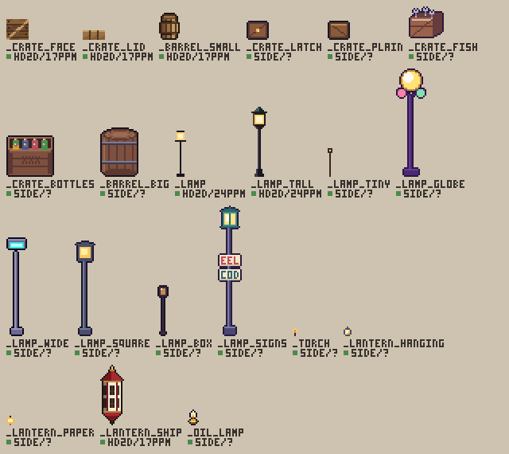
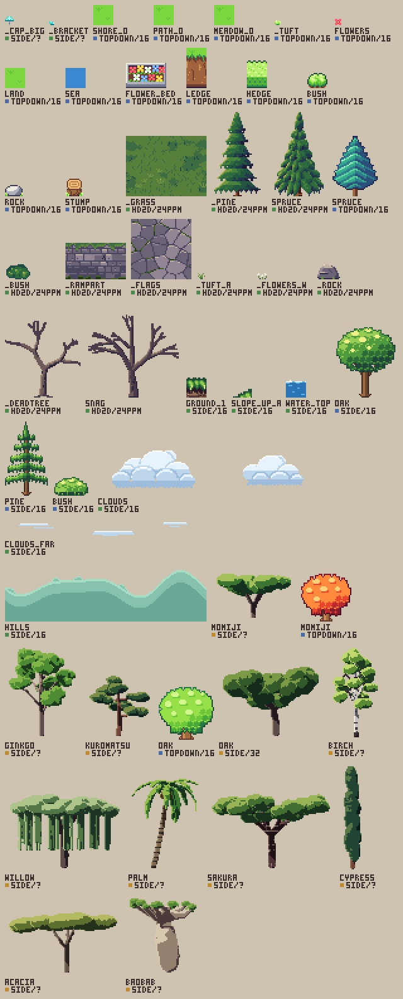
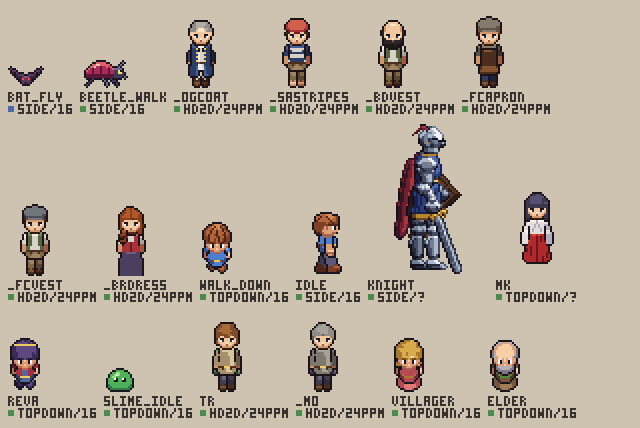
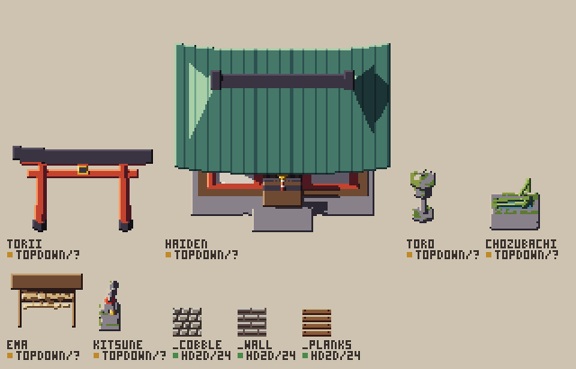
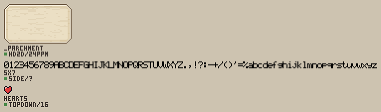
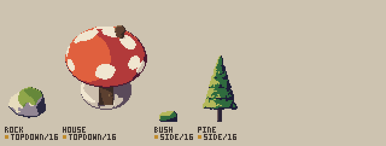

# The library

What pxl draws with, in three layers:

- **the engine** (`src/`): the ops, the builders, the cameras, the light, the export;
- **the library** (here): entries to include rather than redraw, the styles, the profiles;
- **the examples** (`examples/`): finished work, each a profile × entries × a style.

## Taking an entry

Each file holds one kind of thing and says how to take it, in its first lines:

```js
include("<pxl>/lib/props/lamps.px.js", { as: "lamps" })   // its names under lamps.: stamp("lamps._lamp", 40, 60)
sprite("lamp", { base: "lamps._lamp_square", swap: roleSwap(lamps.ROLES._lamp_square, { line: "k", frame: "nM", light: "Llw" }) })
```

- `as` keeps its names apart from yours. Its palette stays with its own drawings unless the file says
  `{ palette: true }` (the nature kit, the HD-2D profile): then its keys are yours too.
- A drawing comes in the colors of the scene it was made for. Its roles (`<kit>.ROLES`) name its keys by
  what they paint (line, wood, light), so `roleSwap()` gives it yours by `base` and `swap`.
- A kit hands out functions and data too (`trees.mats`, `nature.spruce()`, `dialog.PARCHMENT`); the
  names it hands out are full ones (`own()`).
- A 3D thing is a builder, `make3d.oak()`: drawn by `turnaround()` or `draw3d()` at any camera and size.

## What exists, and at which cells

`pxl lib` lists the entries by subject, a line each, with their cells: the camera and the density each
exists at (a tile's px, `topdown/16`; px a meter in a world with no tiles, `hd2d/24ppm`), ✓ approved,
◐ a 3D render to look at, ✎ by hand over a 3D draft (`side/?`: drawn for one scene, neither).
`pxl lib --genre topdown16` keeps those at a profile's cell, `pxl lib --cell side/32` those at a cell.
`pxl lib traveler.tr` prints one's card: what it is, its source, its size, pivot, sockets and frames,
its roles, what varies, and the `include` that takes it. A 3D entry a genre lacks: `pxl lib draft
make3d.oak --genre topdown16` writes and builds an art file to start from, in the genre's camera (what
stands at its figure's pitch), the card's box of tiles, its tones and line (`--cell topdown/16`: a cell
alone). A 2D entry at a new density is redrawn simpler, never scaled (`pxl help "scenes 18 19"`).

Each entry's card is a `card()` call just after it in its file: a renamed entry or asset fails the
load at the card's line, and `pxl check` on the file warns where a cell's status disagrees with how
its asset is drawn. A new entry gets one.

## The sheets

Each card's cells, frame 0, its name and cell under it (the swatch: green ✓, amber ◐, blue ✎); a
builder drawn at its first cell. Made by `node scripts/gallery.ts --lib`.

**Props** (`props/`): lamps and crates from the examples' scenes.



**Nature** (`nature/`): the kit's ground, pines, bushes, rocks and dead trees; the tree species as
builders; the cave's caps.



**Characters** (`characters/`): the traveler and the people on his figure (the crew, the miko), the
top-down hero, the knight.



**Architecture** (`architecture/`): the shrine's builders, the HD-2D surfaces.



**UI** (`ui/`): the dialogue box, the 5x7 font.



**Styles** (`styles/`): the engine's own builders (`make3d.rock`, `house`, `bush`, `pine`) in the
fields style, drafted at their first cells.



`styles/` holds palettes (and, in `fields`, the cards of the engine's own builders, `make3d.rock`,
`house`, `bush`, `pine`, drawn in its colors), `profiles/` the genres (`topdown16`, `topdown32`,
`platformer16`, `hd2d`, `fighting`, `racing_behind`, `racing_topdown`: each number's source beside
it) and their starter kits, `vfx/` the volumes' densities.
